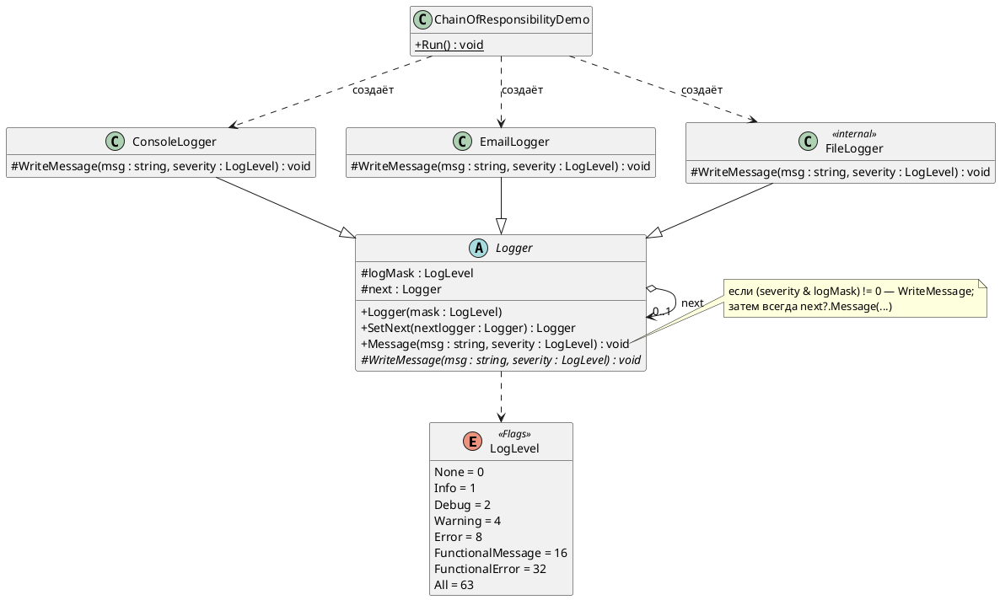

# Лабораторная работа 4 (ЛР 1 практикума). Git, среда и SOLID

**Студент:** Фамилия Имя, группа
**Вариант:** 12 — логи Nginx (`error.log`), приёмники: SQLite, файл; особое требование — разбор кода ответа
**Репозиторий:** https://github.com/securemailcode686-droid/Lecture_Examples
**Pull Request:** ссылка

---

## Задача

Настроить процесс, в котором будут сдаваться все пять работ: форк учебного
репозитория, ветки `main` / `develop` / `feature/*`, CI со сборкой и тестами,
каркас solution LogHub. Затем разобрать god-класс `LogProcessingModule`, найти
в нём нарушения SOLID и разделить его на слои так, чтобы новый приёмник
добавлялся только новыми файлами, тесты не трогали диск, а вывод на тех же
данных совпадал с исходным.

---

## Часть A. Процесс и каркас

| Что | Как сделано |
|---|---|
| Репозиторий | форк `clgray/Lecture_Examples`; `origin` — форк, `upstream` — репозиторий преподавателя |
| Ветки | `main` защищена (только через PR), `develop` — ветка по умолчанию, работа в `feature/лр-1-*` |
| Solution | `LogHub/LogHub.sln`: `LogHub` (консольное приложение) и `LogHub.Tests` (MSTest) |
| Общие настройки | `LogHub/Directory.Build.props` повторяет `DesignPatterns/Directory.Build.props`, плюс `Nullable` и `TreatWarningsAsErrors`; версии пакетов — как в `DesignPatterns/Directory.Packages.props` |
| CI | `.github/workflows/build.yml` учебного репозитория без изменений в его шагах; добавлены restore → build → test для `LogHub/LogHub.sln` |
| Релиз | тег `v0.1.0` «Каркас LogHub» на `main` после слияния части A |

```text
$ git remote -v
origin    https://github.com/securemailcode686-droid/Lecture_Examples.git (fetch)
origin    https://github.com/securemailcode686-droid/Lecture_Examples.git (push)
upstream  https://github.com/clgray/Lecture_Examples.git (fetch)
upstream  https://github.com/clgray/Lecture_Examples.git (push)
```

---

## Разбор чужого кода: Цепочка обязанностей

Папка: [`DesignPatterns/Implementation/Behavioral/ChainOfResponsibility`](../DesignPatterns/Implementation/Behavioral/ChainOfResponsibility).
Запуск: `dotnet run --project Implementation -- chain`.
Выбрана потому, что в ЛР 4 практикума фильтры LogHub станут Цепочкой
обязанностей, и полезно заранее понять, чем учебный вариант отличается
от того, что понадобится.



**Какая задача решается.** Одно сообщение лога нужно доставить в несколько
мест — консоль, почту, файл, — и у каждого места свой набор интересующих
его уровней. Клиент не должен знать, сколько приёмников и какие у них
правила: он отдаёт сообщение голове цепочки (`logger.Message(...)`) и больше
ни о чём не думает.

**Как.** Абстрактный `Logger` хранит маску уровней (`logMask`) и ссылку на
следующий обработчик (`next`). Метод `Message` (`Logger.cs:34`) — шаблонный:
проверяет маску побитовым `&` по `[Flags]`-перечислению `LogLevel`, при
совпадении вызывает абстрактный `WriteMessage`, а затем **в любом случае**
передаёт сообщение дальше. Наследники переопределяют только `WriteMessage`.
Цепочка собирается в `ChainOfResponsibilityDemo.Run` (`ChainOfResponsibility.cs:9`):
`SetNext` проходит до хвоста и дописывает туда новый обработчик, а возвращает
`this`, то есть голову, — поэтому вызовы можно склеивать через точку.
В итоге сообщение уровня `Warning` попадает и в консоль (маска `All`), и в
файл (маска `Warning | Error`), а `FunctionalError` — в консоль и почту.

**Что заметил при чтении.**

* Это не классическая «первый подходящий обработал — дальше не передаём»,
  а рассылка по всей цепочке: остановить сообщение ни один обработчик не
  может. По сути, совмещены Цепочка обязанностей и Шаблонный метод.
* `SetNext` каждый раз идёт до конца цепочки, а защиты от цикла нет:
  `logger.SetNext(logger)` замкнёт цепочку на себя, и следующий `Message`
  закончится `StackOverflowException`.
* `FileLogger` объявлен без модификатора доступа (то есть `internal`), а
  `ConsoleLogger` и `EmailLogger` — `public`; поля `logMask` и `next` —
  `protected` и изменяемые, наследник может перецепить цепочку.
* Для LogHub понадобится обратное поведение: фильтр должен уметь
  **отбросить** запись, а не просто «не обработать» её. Значит, в ЛР 4
  решение о передаче дальше придётся отдать самому обработчику.
