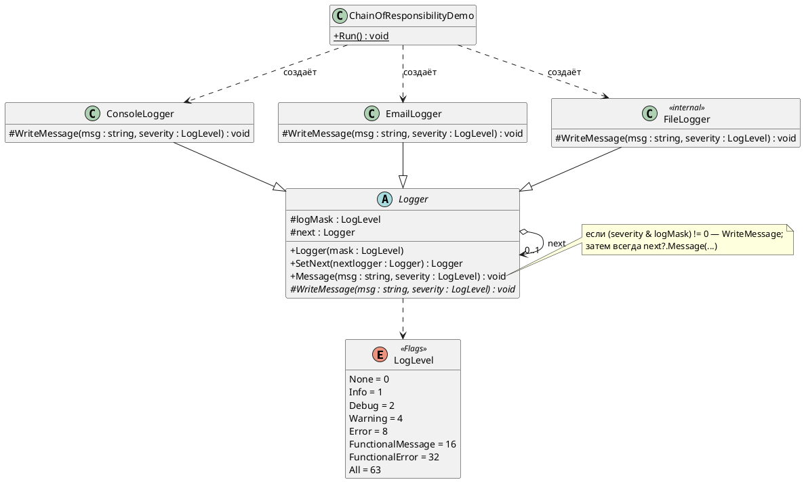
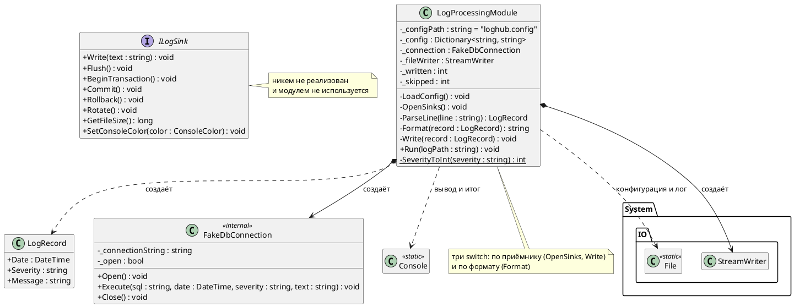
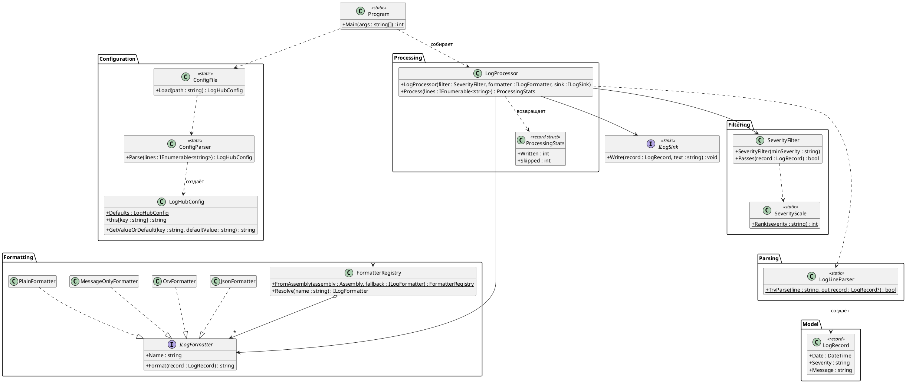
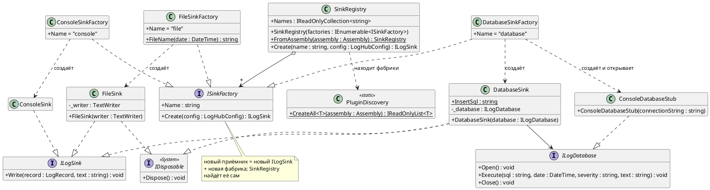

# Лабораторная работа 4 (ЛР 1 практикума). Git, среда и SOLID

**Студент:** Фамилия Имя, группа
**Вариант:** 12 — логи Nginx (`error.log`), приёмники: SQLite, файл; особое требование — разбор кода ответа
**Репозиторий:** https://github.com/securemailcode686-droid/Lecture_Examples
**Pull Request:** ссылка

---

## Задача

Настроить процесс, в котором будут сдаваться все пять работ: форк учебного
репозитория, ветки `main` / `develop` / `feature/*`, CI со сборкой и тестами,
каркас solution LogHub. Затем разобрать god-класс `LogProcessingModule`, найти
в нём нарушения SOLID и разделить его на слои так, чтобы новый приёмник
добавлялся только новыми файлами, тесты не трогали диск, а вывод на тех же
данных совпадал с исходным.

---

## Часть A. Процесс и каркас

| Что | Как сделано |
|---|---|
| Репозиторий | форк `clgray/Lecture_Examples`; `origin` — форк, `upstream` — репозиторий преподавателя |
| Ветки | `main` защищена (только через PR), `develop` — ветка по умолчанию, работа в `feature/лр-1-*` |
| Solution | `LogHub/LogHub.sln`: `LogHub` (консольное приложение) и `LogHub.Tests` (MSTest) |
| Общие настройки | `LogHub/Directory.Build.props` повторяет `DesignPatterns/Directory.Build.props`, плюс `Nullable` и `TreatWarningsAsErrors`; версии пакетов — как в `DesignPatterns/Directory.Packages.props` |
| CI | `.github/workflows/build.yml` учебного репозитория без изменений в его шагах; добавлены restore → build → test для `LogHub/LogHub.sln` |
| Релиз | тег `v0.1.0` «Каркас LogHub» на `main` после слияния части A |

```text
$ git remote -v
origin    https://github.com/securemailcode686-droid/Lecture_Examples.git (fetch)
origin    https://github.com/securemailcode686-droid/Lecture_Examples.git (push)
upstream  https://github.com/clgray/Lecture_Examples.git (fetch)
upstream  https://github.com/clgray/Lecture_Examples.git (push)
```

---

## Разбор чужого кода: Цепочка обязанностей

Папка: [`DesignPatterns/Implementation/Behavioral/ChainOfResponsibility`](../DesignPatterns/Implementation/Behavioral/ChainOfResponsibility).
Запуск: `dotnet run --project Implementation -- chain`.
Выбрана потому, что в ЛР 4 практикума фильтры LogHub станут Цепочкой
обязанностей, и полезно заранее понять, чем учебный вариант отличается
от того, что понадобится.



**Какая задача решается.** Одно сообщение лога нужно доставить в несколько
мест — консоль, почту, файл, — и у каждого места свой набор интересующих
его уровней. Клиент не должен знать, сколько приёмников и какие у них
правила: он отдаёт сообщение голове цепочки (`logger.Message(...)`) и больше
ни о чём не думает.

**Как.** Абстрактный `Logger` хранит маску уровней (`logMask`) и ссылку на
следующий обработчик (`next`). Метод `Message` (`Logger.cs:34`) — шаблонный:
проверяет маску побитовым `&` по `[Flags]`-перечислению `LogLevel`, при
совпадении вызывает абстрактный `WriteMessage`, а затем **в любом случае**
передаёт сообщение дальше. Наследники переопределяют только `WriteMessage`.
Цепочка собирается в `ChainOfResponsibilityDemo.Run` (`ChainOfResponsibility.cs:9`):
`SetNext` проходит до хвоста и дописывает туда новый обработчик, а возвращает
`this`, то есть голову, — поэтому вызовы можно склеивать через точку.
В итоге сообщение уровня `Warning` попадает и в консоль (маска `All`), и в
файл (маска `Warning | Error`), а `FunctionalError` — в консоль и почту.

**Что заметил при чтении.**

* Это не классическая «первый подходящий обработал — дальше не передаём»,
  а рассылка по всей цепочке: остановить сообщение ни один обработчик не
  может. По сути, совмещены Цепочка обязанностей и Шаблонный метод.
* `SetNext` каждый раз идёт до конца цепочки, а защиты от цикла нет:
  `logger.SetNext(logger)` замкнёт цепочку на себя, и следующий `Message`
  закончится `StackOverflowException`.
* `FileLogger` объявлен без модификатора доступа (то есть `internal`), а
  `ConsoleLogger` и `EmailLogger` — `public`; поля `logMask` и `next` —
  `protected` и изменяемые, наследник может перецепить цепочку.
* Для LogHub понадобится обратное поведение: фильтр должен уметь
  **отбросить** запись, а не просто «не обработать» её. Значит, в ЛР 4
  решение о передаче дальше придётся отдать самому обработчику.

---

## Часть B. Рефакторинг god-класса

### Исходный класс

[`DesignPatterns/Implementation/_AntiPatterns/GodObject/LogProcessingModule.cs`](../DesignPatterns/Implementation/_AntiPatterns/GodObject/LogProcessingModule.cs),
316 строк. Метод `Run(logPath)` читает `loghub.config` из текущего каталога
(или берёт `console` / `Info` / `plain`), открывает приёмник (`console`,
`file` → `logs-ГГГГММДД.txt`, `database` → заглушка `FakeDbConnection`),
разбирает строки `дата|уровень|сообщение`, отбрасывает записи ниже порога,
форматирует (`plain`, `json`, `csv`, иначе — только сообщение), пишет и
печатает `Записано: X, пропущено: Y`.

Код класса в LogHub не копировался: решение написано заново по
наблюдаемому поведению, а для сравнения исходный класс запускается
из учебного проекта как есть (см. «Поведение не изменилось»).

### Найденные нарушения SOLID

Номера строк — по файлу учебного репозитория (коммит `31a3515`).
«Помечено» — есть ли подсказка в комментариях файла.

| № | Принцип | Строки | Помечено | Что не так | Где исправлено |
|---|---|---|---|---|---|
| 1 | SRP | 32–258 | да | Шесть причин изменения в одном классе: формат конфигурации, хранилище, формат логов, формат вывода, набор приёмников, правила фильтрации (комментарии «Причина изменения №1–6», стр. 49, 80, 109, 140, 165, 227) | разнесено по слоям, см. ниже |
| 2 | SRP | 52–77 | да | Модуль обработки сам читает и разбирает файл конфигурации | `ConfigFile`, `ConfigParser` |
| 3 | SRP | 83–106 | да | Модуль сам открывает соединение с БД и файл | фабрики приёмников |
| 4 | SRP | 112–137 | да | Разбор строки лога внутри модуля | `LogLineParser` |
| 5 | SRP | 143–162 | да | Форматирование внутри модуля | `ILogFormatter` и реализации |
| 6 | SRP | 168–201 | да | Один метод и выбирает приёмник, и пишет в три разных хранилища | `SinkRegistry` + по классу на приёмник |
| 7 | SRP | 184–186 | да | Политика сброса буфера решается в коде маршрутизации | `FileSink.Write` |
| 8 | SRP | 190–196 | да | Раскраска консоли — в коде маршрутизации | `ConsoleSink` |
| 9 | SRP | 227–232 | да | Фильтрация зашита в цикл `Run` | `SeverityFilter` |
| 10 | SRP | 242 | нет | Модуль сам решает, как показать итог пользователю (печать в консоль) | `LogProcessor` возвращает `ProcessingStats`, печатает `Program` |
| 11 | SRP | 37, 45–46 | нет | Состояние прогона хранится в полях: второй `Run` на том же объекте продолжит счёт с прошлых значений и унаследует ключи прошлой конфигурации | счётчики — локальные переменные `Process`, конфигурация — значение |
| 12 | OCP | 87–105 | да | `switch` по приёмнику №1: новый приёмник — правка метода | `SinkRegistry` + `ISinkFactory` |
| 13 | OCP | 174–198 | да | `switch` по приёмнику №3, править синхронно с №12 | `ILogSink.Write` у каждого приёмника свой |
| 14 | OCP | 146–161 | да | `switch` по формату (№2): новый формат — правка метода | `FormatterRegistry` + `ILogFormatter` |
| 15 | OCP | 114–116 | да | Формат строки зашит, другой формат — только правкой метода | частично: формат изолирован в `LogLineParser`; точка расширения — в ЛР 3 (см. «Ключевые решения») |
| 16 | OCP | 57–60 | да | Значения по умолчанию зашиты в метод чтения | `LogHubConfig.Defaults` — одно место рядом с именами ключей |
| 17 | OCP | 96 | да | Шаблон имени файла вычисляется в `OpenSinks` | `FileSinkFactory.FileName` |
| 18 | OCP | 245–257 | да | Шкала уровней — `switch`, новый уровень — правка метода | `SeverityScale` (таблица в одном месте) |
| 19 | LSP | 260–274 | да | Ни один приёмник не может честно реализовать `ILogSink`: консоль бросала бы `NotSupportedException` в `BeginTransaction`/`Commit`, база — в `Rotate`/`GetFileSize`. Код, вызывающий `Commit`, сломается при подстановке консоли | новый `ILogSink` из одного метода, который выполним для всех |
| 20 | LSP | 118–129 | да | Сигнатура обещает `LogRecord`, а метод возвращает `null`; постусловие не выражено в контракте, вызывающий обязан «помнить» (стр. 219–221) | `TryParse(string, out LogRecord?)` с `[NotNullWhen(true)]` |
| 21 | ISP | 264–274 | да | 8 методов четырёх ролей: запись, транзакции, ротация и размер файла, цвет консоли | `ILogSink.Write`; освобождение — `IDisposable` только у `FileSink` и `DatabaseSink`; транзакции, ротация и цвет не выделены — их никто не вызывает |
| 22 | DIP | 264–274, 168–201 | нет | Абстракция приёмника объявлена, но модуль ею не пользуется: зависит от `FakeDbConnection`, `StreamWriter` и `Console` напрямую | `LogProcessor` знает только `ILogSink` |
| 23 | DIP | 36 | да | Путь к конфигурации зашит в поле, подменить нельзя | путь передаётся в `ConfigFile.Load` из `Program` |
| 24 | DIP | 40, 90 | да | Модуль создаёт конкретный клиент БД | `DatabaseSink` зависит от `ILogDatabase`, клиента создаёт фабрика |
| 25 | DIP | 43, 96 | да | Модуль создаёт `StreamWriter` | `FileSink` принимает любой `TextWriter` |
| 26 | DIP | 55, 64 | да | `File.Exists` / `File.ReadAllLines` в бизнес-логике | только в `ConfigFile`; `ConfigParser` принимает строки |
| 27 | DIP | 215 | да | `File.ReadLines` в цикле обработки: тест требует настоящий файл | `LogProcessor.Process(IEnumerable<string>)`, файл открывает `Program` |
| 28 | DIP | 191–196, 242 | нет | Статический `Console` в обработке: вывод не проверить | `Console` остался в `ConsoleSink`, `ConsoleDatabaseStub` и `Program` |
| 29 | DIP | 96 | нет | `DateTime.Now` внутри обработки: имя файла зависит от системных часов | `FileSinkFactory.FileName(DateTime)` проверяется с заданной датой, `DateTime.Now` — только в фабрике |
| 30 | — | 237–240 | да | Освобождение ресурсов без `using` и `try/finally`: исключение оставит файл открытым | `finally` в `Program` |

Найдено, но **сохранено** — иначе изменилось бы поведение:

| Строки | Что | Почему не исправлено |
|---|---|---|
| 152–154 | В JSON экранируются только кавычки: `\` в сообщении даёт невалидный JSON | Исправление меняет вывод; отдельная задача |
| 223, 230 | Неразобранные строки и отфильтрованные записи — в одном счётчике `_skipped` | Итог «пропущено» должен совпадать |
| 192, 248 | Уровни сравниваются с учётом регистра: `error` не красный и считается Info | То же |
| 55–76, 211 | Значения по умолчанию действуют, только если файла нет вовсе; файл без `minSeverity` роняет программу `KeyNotFoundException` | То же |

### Как разделён класс

Проверочный вопрос из задания — *кто придёт с требованием изменить класс?*

| Слой | Класс | Единственная причина изменения | Кто придёт |
|---|---|---|---|
| Чтение | `ConfigFile` | где лежит конфигурация | администратор развёртывания |
| | `ConfigParser` | синтаксис файла конфигурации | тот же администратор, но по другому поводу — сменить формат |
| | `LogHubConfig` | набор ключей и значения по умолчанию | владелец продукта |
| | `IEnumerable<string>` из `File.ReadLines` в `Program` | откуда берутся строки | — (появится `ILogSource` в ЛР 3) |
| Разбор | `LogLineParser` | формат строки лога | команда сервиса, который пишет логи |
| Фильтрация | `SeverityScale` | набор уровней и их порядок | тот, кто вводит новый уровень |
| | `SeverityFilter` | правило отбора по порогу | эксплуатация |
| Форматирование | `PlainFormatter`, `JsonFormatter`, `CsvFormatter`, `MessageOnlyFormatter` | вид одной строки вывода | потребитель конкретного формата |
| | `FormatterRegistry` | как формат выбирается по имени | — |
| Запись | `ConsoleSink` | как выглядит вывод в консоли | оператор, читающий консоль |
| | `FileSink` / `FileSinkFactory` | запись строк в поток / имя и открытие файла | эксплуатация (ротация, каталог) |
| | `DatabaseSink` / `DatabaseSinkFactory` | соответствие записи колонкам таблицы / подключение | администратор БД |
| | `ConsoleDatabaseStub` | заглушка клиента БД | заменится SQLite в ЛР 5 |
| | `SinkRegistry`, `PluginDiscovery` | как приёмник выбирается по имени и находится в сборке | — |
| Конвейер | `LogProcessor` | порядок шагов и подсчёт итога | — |
| Сборка | `Program` | какие конкретные классы используются | — |

### `switch` по типу приёмника убран

Два `switch` по `_config["sink"]` (стр. 87 и 174) и знание о каждом
приёмнике при освобождении ресурсов (стр. 239–240) заменены одним поиском
по имени в `SinkRegistry` и `IDisposable` у тех приёмников, которым есть
что освобождать. Список приёмников нигде не
перечисляется: `SinkRegistry.FromAssembly` находит в сборке все открытые
реализации `ISinkFactory` с конструктором без параметров
(`LogHub/src/LogHub/Composition/PluginDiscovery.cs`).

Проверка OCP. Добавлен пробный приёмник Telegram — два файла:

```csharp
public sealed class TelegramSinkFactory : ISinkFactory
{
	public string Name => "telegram";

	public ILogSink Create(LogHubConfig config)
	{
		return new TelegramSink(config["telegramChat"]);
	}
}
```

```text
$ git add -A && git diff --cached --name-status
A	LogHub/src/LogHub/Sinks/TelegramSink.cs
A	LogHub/src/LogHub/Sinks/TelegramSinkFactory.cs
```

Только новые файлы (`A`), ни одного изменённого (`M`). После проверки
пробный приёмник удалён — на защите он добавляется заново.

### Поведение не изменилось

`LogHub/tools/compare-with-god-object.sh` (шаг CI «LogHub — вывод совпадает
с исходным god-object») запускает оба варианта на одном входе
[`LogHub/samples/god-object-input.log`](../LogHub/samples/god-object-input.log)
(32 строки: все пять уровней, неизвестные уровни, пустые и неразбираемые
строки, черта и кавычки в сообщении, разные записи даты) в отдельных
каталогах с одинаковым `loghub.config` и сравнивает стандартный вывод
(включая итог), код возврата, первую строку stderr и созданные файлы
`logs-*.txt`. Исходный класс запускается через `LogHub/tools/LegacyRunner`,
который ссылается на проект `DesignPatterns/Implementation` — копии кода нет.

| Случай | Что проверяет |
|---|---|
| нет-конфигурации | значения по умолчанию: консоль, Info, plain |
| консоль-debug-json | порог Debug, JSON и экранирование кавычек |
| файл-warning-csv | приёмник `file`: имя, содержимое, CSV |
| бд-со-строкой-подключения | комментарий, пробелы вокруг `=`, `=` внутри значения, вывод заглушки БД |
| бд-по-умолчанию-неизвестный-формат | `connection = local` по умолчанию, неизвестный формат → только сообщение |
| комментарии-и-переопределение | пустые строки, строка без `=`, повторный ключ |
| неизвестный-порог | неизвестный `minSeverity` = Info |
| неизвестный-приёмник | `NotSupportedException` с тем же текстом |
| нет-ключа-sink | `KeyNotFoundException`, когда файл есть, а ключа нет |

Осознанные отличия есть только на аварийном пути, и оба — следствие
исправления №30:

* если после открытия приёмника случилось исключение (нет файла лога,
  нет ключа `minSeverity` или `format`), LogHub всё равно закрывает
  приёмник — для `database` в выводе появляется строка
  `[БД] соединение закрыто`, которой у исходного класса нет;
* форматтер выбирается до чтения лога, поэтому файл конфигурации без
  ключа `format` роняет LogHub сразу, а исходный класс — только на первой
  записанной строке (если ни одна запись не прошла фильтр, он отработает
  без ошибки).

### Что стало проще менять

Новый приёмник, формат вывода или уровень теперь меняют ровно одно место:
приёмник и формат — новыми файлами, без правки существующих, уровень —
одной строкой в `SeverityScale`. Формат строки лога живёт в одном классе,
так что формат Nginx из моего варианта в ЛР 3 не заденет ни фильтрацию,
ни приёмники. Каждый слой проверяется отдельно и без диска: разбор и
фильтр — строками, приёмники — `StringWriter` и поддельной базой,
маршрутизация — фабриками-шпионами. Заглушку БД можно заменить на SQLite,
не трогая `DatabaseSink`: ему нужен только `ILogDatabase`. Обратная
сторона — вместо одного класса стало 28 типов, и чтобы понять, что делает
программа целиком, теперь нужно начинать с `Program.cs`.

---

## Диаграммы классов

### До рефакторинга



### После рефакторинга: конвейер



### После рефакторинга: приёмники



---

## Применённые паттерны и приёмы

| Паттерн / приём | Где | Почему именно он |
|---|---|---|
| Фабричный метод | `ISinkFactory.Create` и три фабрики | Приёмникам при создании нужно разное: файлу — имя по дате, базе — строка подключения и открытие. Фабрика держит это знание рядом с приёмником, а реестр вызывает их одинаково. Без фабрики выбор конструктора снова оказался бы в общем `switch` |
| Стратегия | `ILogFormatter` в `LogProcessor` | Формат меняется независимо от остального конвейера и выбирается при запуске. Шаблонный метод (наследник `LogProcessor` на каждый формат) смешал бы формат с порядком обработки |
| Реестр + поиск реализаций | `SinkRegistry`, `FormatterRegistry`, `PluginDiscovery` | Критерий OCP механический: список фабрик в `Program` попал бы в `git diff` при добавлении приёмника. Поиск по сборке убирает список совсем |
| Композиционный корень | `Program.Main` | Только здесь выбираются конкретные классы и только здесь программа касается файла лога; остальные классы получают зависимости через конструктор |

---

## Ключевые решения

* **Почему `ILogSink.Write(record, text)`, а не `Write(text)`.** Консоли нужен
  уровень (цвет), базе — дата и уровень (отдельные колонки), всем — готовый
  текст. Исходный модуль передавал ровно это (стр. 177–179). Если бы каждый
  приёмник форматировал сам, выбор формата размножился бы по приёмникам.
* **Где интерфейсы, а где нет.** Интерфейсы — там, где реализаций больше
  одной или подмена нужна тестам: `ILogSink` (3 + шпион), `ISinkFactory`
  (3 + поддельные), `ILogFormatter` (4), `ILogDatabase` (заглушка + поддельная
  база, в ЛР 5 — SQLite). Без интерфейса: `LogLineParser` (формат один,
  разбор чистый — тестам подменять нечего), `SeverityFilter` (одно правило),
  чтение (`IEnumerable<string>` уже абстракция). Они станут Стратегией и
  Цепочкой обязанностей в ЛР 3–4, когда появится второй вариант.
* **`IDisposable` не входит в `ILogSink`.** Консоли нечего освобождать;
  `Program` освобождает приёмник через `(sink as IDisposable)?.Dispose()`.
* **Порядок шагов в `Program`** повторяет исходный `Run`: конфигурация →
  приёмник → порог → чтение. От порядка зависит, что успеет напечататься
  до исключения, — а это тоже поведение.

---

## Тесты

38 тестов (28 методов, часть — с `DataRow`), ни один не обращается к диску,
сети или базе:

| Класс тестов | Что покрыто |
|---|---|
| `LogLineParserTests` | разбор корректной строки, обрезка пробелов, `\|` в сообщении, 4 вида неразбираемых строк |
| `ConfigParserTests` | комментарии и пустые строки, `=` в значении, повторный ключ, отсутствующий ключ, значения по умолчанию |
| `SeverityFilterTests` | 8 сочетаний порога и уровня, включая неизвестные и регистр |
| `FormatterTests` | plain, json, csv, неизвестный формат, найденные в сборке форматтеры |
| `SinkRegistryTests` | маршрутизация по имени, текст исключения для неизвестного приёмника, регистр имени, найденные в сборке фабрики |
| `LogProcessorTests` | вход демо `god-object` → 3 записано / 2 пропущено и тексты, фильтр не пускает в приёмник, приёмник получает запись и текст, пустой вход |
| `FileSinkTests` | строка на запись и сброс буфера (через `StringWriter`), закрытие потока, имя файла по дате |
| `DatabaseSinkTests` | вставка в `logs` с нужными значениями, закрытие соединения |

Проверка, что тесты не трогают внешний мир:

```text
$ grep -rnE "\b(File|Path|Directory|Console)\.|GetTempFileName" LogHub/tests
$
```

Сравнение с исходным классом — отдельно, в CI (см. «Поведение не изменилось»):
оно запускает программы на файлах и поэтому сделано скриптом, а не тестом.

---

## Что не получилось

* **Полного совпадения на аварийном пути нет** — сознательно, см. два
  отличия в разделе «Поведение не изменилось». Можно было повторить и
  утечку ресурсов, но тогда исправление №30 пришлось бы отложить.
* **Формат строки лога пока не расширяем без правки** (нарушение №15
  исправлено частично): интерфейса разбора нет, потому что формат один.
  Он появится в ЛР 3 вместе с форматом Nginx.
* **`ConsoleSink` и `ConsoleDatabaseStub` не покрыты модульными тестами**:
  они пишут в глобальную консоль. Их вывод проверяется только сравнением
  с исходным классом.
* **Поиск реализаций через рефлексию** требует, чтобы фабрика была
  открытой и с конструктором без параметров. Ошибка (например, два
  приёмника с одним именем) обнаружится только при запуске — исключением
  из `ToDictionary`.
* Сложнее всего было не «улучшить» заодно: экранирование JSON, общий
  счётчик пропущенных и регистр уровней так и оставлены (таблица выше).

---

## Источники

* Учебный репозиторий: `DesignPatterns/Implementation/_AntiPatterns/GodObject/LogProcessingModule.cs`
  (исходное поведение), `Behavioral/ChainOfResponsibility` (разбор), `.github/workflows/build.yml` (основа CI).
* Учебник курса, главы «SOLID» и «Диаграммы на PlantUML».
* При подготовке кода, тестов, скрипта сравнения и текста отчёта
  использовалась языковая модель Claude (Anthropic). Сгенерированное
  проверено: сборка, тесты и сравнение с исходным классом выполняются в CI.
