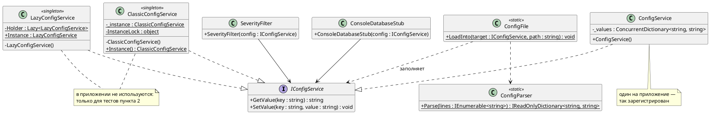
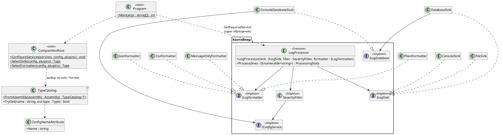

# Лабораторная работа 5 (ЛР 2 практикума). IoC, DI-контейнер и Синглтон

**Студент:** Кириллов Никита, БИСО-02-24\
**Вариант:** 12 — логи Nginx (`error.log`), приёмники: SQLite, файл; особое требование — разбор кода ответа\
**Репозиторий:** https://github.com/securemailcode686-droid/Lecture_Examples\
**Pull Request:** https://github.com/securemailcode686-droid/Lecture_Examples/pull/5

---

## Задача

Реализовать сервис конфигурации тремя способами — классическим синглтоном,
синглтоном через `Lazy<T>` и обычным классом — и тестами воспроизвести,
почему глобальная точка доступа ломает тестируемость. Затем собрать LogHub
из ЛР 1 на `Microsoft.Extensions.DependencyInjection`: зависимости только
через конструктор, `new` для сервисов только в корне, одно обращение к
контейнеру; поведение переключается профилем конфигурации без перекомпиляции.

---

## Три реализации `IConfigService`

| Реализация | Файл | Кто обеспечивает единственность | Как получают экземпляр |
|---|---|---|---|
| Классический синглтон | [`ClassicConfigService.cs`](../LogHub/src/LogHub/Configuration/ClassicConfigService.cs) | сам класс: приватный конструктор, `lock` на каждый вызов `Instance()` | `ClassicConfigService.Instance()` из любого места |
| Синглтон через `Lazy<T>` | [`LazyConfigService.cs`](../LogHub/src/LogHub/Configuration/LazyConfigService.cs) | сам класс, но потокобезопасность гарантирует `Lazy<T>` | `LazyConfigService.Instance` из любого места |
| Обычный класс | [`ConfigService.cs`](../LogHub/src/LogHub/Configuration/ConfigService.cs) | контейнер: `services.AddSingleton(config)` | через конструктор того, кому он нужен |

Приложение использует только `ConfigService`. Первые два класса в сборке есть,
но ни один сервис LogHub на них не ссылается — они нужны для тестов пункта 2.



---

## Проблема на тестах

Главный тест работы — пара с одной и той же проверкой «у нового сервиса
нет порога `minSeverity`»:

| Тест | Реализация | Результат |
|---|---|---|
| [`ClassicConfigServiceTests.НовыйСервис_ПорогНеЗадан`](../LogHub/tests/LogHub.Tests/Configuration/ClassicConfigServiceTests.cs) | классический синглтон | в одиночку проходит, в наборе падает; отключён `[Ignore("…")]` |
| [`ConfigServiceTests.НовыйСервис_ПорогНеЗадан`](../LogHub/tests/LogHub.Tests/Configuration/ConfigServiceTests.cs) | обычный класс | проходит всегда, в любом порядке и параллельно |

**Почему синглтон падает в наборе.** В том же классе раньше объявлен
обычный, сам по себе правильный тест `Порог_ЗаписываетсяИЧитается`: он
пишет `minSeverity = Warning` в `ClassicConfigService.Instance()`.
Экземпляр один на весь процесс тестов, поэтому к моменту проверки порог
уже задан, и ожидаемого `KeyNotFoundException` нет. Сбросить состояние
нечем: конструктор приватный, а метод `Reset()` означал бы, что код
приложения подстраивается под тесты. Запуск в одиночку проходит только
потому, что экземпляр создаётся впервые.

**Как воспроизвести.** Атрибут `Ignore` стоит под условной компиляцией,
и шаг CI «LogHub — классический синглтон зависит от порядка тестов»
([`tools/show-singleton-order-problem.sh`](../LogHub/tools/show-singleton-order-problem.sh))
собирает тесты с `-p:ShowOrderProblem=true`, где атрибута нет:

```bash
dotnet build LogHub/tests/LogHub.Tests -c Debug -p:ShowOrderProblem=true
# 1. в одиночку — проходит
dotnet test LogHub/tests/LogHub.Tests -c Debug --no-build \
  --filter "FullyQualifiedName~ClassicConfigServiceTests.НовыйСервис_ПорогНеЗадан"
# 2. в наборе своего класса — падает
dotnet test LogHub/tests/LogHub.Tests -c Debug --no-build \
  --filter "FullyQualifiedName~ClassicConfigServiceTests"
```

Шаг зелёный, только если первый запуск прошёл, а второй упал, — то есть
проблема воспроизводится на каждой сборке, а не описана словами.

**`Lazy<T>` от этого не спасает.** [`LazyConfigServiceTests`](../LogHub/tests/LogHub.Tests/Configuration/LazyConfigServiceTests.cs)
показывает, что он честно решает свою задачу — 64 потока получают один
экземпляр, — но состояние всё так же глобальное: тест
`ЗаписьВидныВсем_СостояниеГлобальное` вынужден брать ключ с `Guid`, чтобы
не столкнуться с соседями. Оба класса синглтонов помечены `[DoNotParallelize]`:
параллельные тесты на общем состоянии стали бы лотереей уже внутри одного прогона.

**Для варианта через контейнер такого теста не существует в принципе:**
каждый тест создаёт свой `ConfigService` (`new ConfigService()` или
`Configs.With(...)`), а тест `AddSingleton_РазныеКонтейнеры_НеВидятЗаписейДругДруга`
показывает, что «один экземпляр» — это свойство конкретного контейнера, а не класса.

---

## Чем Singleton отличается от `AddSingleton`

Оба дают «один экземпляр», но решают разные вещи.

**Паттерн Singleton соединяет два решения в одном классе:** сколько
экземпляров существует и как до него добраться. Второе — глобальная точка
доступа `Instance()` — и ломает тестируемость. Любой код может прочитать
или изменить состояние, не объявляя этого в конструкторе, поэтому:

* состояние переживает тест и попадает в следующий — `НовыйСервис_ПорогНеЗадан`
  у синглтона зависит от порядка;
* подставить другую реализацию нельзя: потребитель сам вызывает
  `ClassicConfigService.Instance()`, а не получает `IConfigService`;
* создать второй, чистый экземпляр нельзя — конструктор приватный.

**`AddSingleton` решает только первое — время жизни** — и оставляет класс
обычным. `ConfigService` не знает, что он один: это решение принято в
[`CompositionRoot`](../LogHub/src/LogHub/Composition/CompositionRoot.cs)
строкой `services.AddSingleton(config)`. Потребители (`SeverityFilter`,
`ConsoleDatabaseStub`) получают `IConfigService` через конструктор, поэтому:

* тест создаёт свой экземпляр — состояние не переносится
  (`ConfigServiceTests.НовыйСервис_ПорогНеЗадан` проходит всегда);
* тест подставляет свою реализацию без всякого сброса статики —
  `CompositionRootTests.СвояРеализацияIConfigService_ПодставляетсяБезСбросаСтатики`
  передаёт `FixedConfig` и проверяет, что `SeverityFilter` взял порог из неё;
* «один на приложение» проверяется тестом на контейнер
  (`AddSingleton_ВОдномКонтейнере_ОдинЭкземпляр`), а два контейнера дают
  два независимых экземпляра (`AddSingleton_РазныеКонтейнеры_НеВидятЗаписейДругДруга`).

Короче: `AddSingleton` — решение об инфраструктуре, которое можно поменять
в одной строке корня; Singleton — ограничение, зашитое в класс и во всех,
кто вызывает `Instance()`.

---

## Композиционный корень

[`Program.Main`](../LogHub/src/LogHub/Program.cs) и
[`CompositionRoot.ConfigureServices`](../LogHub/src/LogHub/Composition/CompositionRoot.cs):

1. `Main` создаёт `ConfigService` и заполняет его из `loghub.config`.
2. `ConfigureServices` по ключам `sink` и `format` выбирает типы приёмника
   и форматтера в каталоге (`TypeCatalog<T>` — открытые классы с атрибутом
   `[ConfigName("…")]`) и регистрирует остальное.
3. `Main` строит провайдер с `ValidateOnBuild` и `ValidateScopes`, берёт
   из него `LogProcessor` — **единственное обращение к контейнеру** — и
   обрабатывает файл. Освобождение провайдера закрывает файл или соединение.



### Проверка требований

| Требование | Как проверить | Результат |
|---|---|---|
| Зависимости через конструктор | у сервисов нет сеттеров зависимостей и статических обращений к другим сервисам | `LogProcessor`, `SeverityFilter`, `DatabaseSink`, `ConsoleDatabaseStub` получают всё в конструкторе |
| `new` для сервисов только в корне | `grep -rn "new [A-Z]" LogHub/src` | вне `Program` — только данные (`LogRecord`, `ProcessingStats`, словари), исключения, `StreamWriter` внутри `FileSink` и самосоздание в двух синглтонах, которые приложение не использует |
| Одно обращение к `IServiceProvider` | `grep -rn "GetService\|GetRequiredService" LogHub/src` | одна строка — `Program.cs` |
| Нет Service Locator | `IServiceProvider` не передаётся ни одному классу и нигде не хранится | — |

### Времена жизни

| Сервис | Время жизни | Почему |
|---|---|---|
| `IConfigService` | Singleton (готовый экземпляр) | одна конфигурация на запуск; читается до сборки контейнера, потому что по ней выбираются типы |
| `ILogSink` | Singleton | держит файл или соединение; открыть нужно один раз и закрыть при освобождении контейнера |
| `ILogFormatter`, `SeverityFilter` | Singleton | без изменяемого состояния; порог читается один раз |
| `ILogDatabase` | Singleton | одно соединение на приёмник |
| `LogProcessor` | Transient | ничего не хранит между вызовами `Process`; зависит только от синглтонов, поэтому захваченной зависимости нет (проверяется `ValidateScopes`) |

---

## Два профиля без перекомпиляции

| Профиль | Файл | Поведение |
|---|---|---|
| `console` | [`LogHub/profiles/console/loghub.config`](../LogHub/profiles/console/loghub.config) | `sink = console`, от Info, plain |
| `file` | [`LogHub/profiles/file/loghub.config`](../LogHub/profiles/file/loghub.config) | `sink = file`, от Warning, CSV в `logs-ГГГГММДД.txt` |

Переключение — копированием файла в `loghub.config` рабочего каталога.
Корень регистрирует другой `ILogSink` и `ILogFormatter`, а ни один сервис
не меняется. Шаг CI «LogHub — профили console и file без перекомпиляции»
([`tools/run-profiles.sh`](../LogHub/tools/run-profiles.sh)) запускает
**одну и ту же** собранную DLL с обоими профилями и проверяет: сборка между
запусками не менялась, профиль `console` файла не создал, профиль `file` —
создал. Тесты `CompositionRootTests.Профиль_ВыбираетПриёмникПоИмени` и
`ПрофильFile_ВКонтейнереРегистрируетсяFileSink` проверяют то же без диска:
файл не открывается, проверяется только регистрация.

Сравнение с исходным god-object из ЛР 1 по-прежнему проходит в CI на всех
девяти конфигурациях — переход на контейнер поведение не изменил.

---

## Применённые паттерны

| Паттерн / приём | Где применён | Почему именно он |
|---|---|---|
| Внедрение через конструктор | все сервисы LogHub | зависимости видны в сигнатуре, тест передаёт подделку без настройки контейнера (`FixedConfig`, `FakeDatabase`, `SpySink`). Внедрение через свойство оставило бы окно, когда объект создан без зависимости |
| Композиционный корень | `Program.Main` + `CompositionRoot` | одно место, где видно, из чего собрано приложение и сколько живёт каждая часть. Второй корень дал бы второй граф с другим поведением |
| DI-контейнер | `Microsoft.Extensions.DependencyInjection` | граф из пяти сервисов ещё собирается вручную, но контейнер даёт освобождение `IDisposable`-приёмников и проверку графа при старте (`ValidateOnBuild`), которые вручную пришлось бы писать самому |
| Singleton (паттерн) | `ClassicConfigService`, `LazyConfigService` | только как объект изучения: в приложении не используется, потому что глобальная точка доступа ломает тесты (см. выше) |
| Каталог реализаций по атрибуту | `TypeCatalog<T>`, `[ConfigName]` | сохраняет критерий OCP из ЛР 1: новый приёмник — один новый файл. Список `if (sink == "file") …` в корне пришлось бы править при каждом приёмнике |

---

## Ключевые решения

* **Фабрики приёмников из ЛР 1 убраны.** `ISinkFactory` создавал приёмник
  через `new` вне корня, а `SinkRegistry` — сами фабрики через рефлексию.
  Теперь корень выбирает **тип** приёмника по конфигурации, а создаёт его
  контейнер, передавая зависимости в конструктор (`DatabaseSink` получает
  `ILogDatabase`, заглушка БД — `IConfigService`). OCP сохранён: Telegram —
  это новый `[ConfigName("telegram")] TelegramSink : ILogSink`, и больше ничего.
* **Конфигурация читается до сборки контейнера.** Иначе выбирать реализацию
  пришлось бы фабричной лямбдой `sp => sp.GetRequiredService…` — это второе
  обращение к провайдеру. Чтение заранее — тот же приём, что в учебнике
  («Смена поведения без перекомпиляции»), только тип берётся из каталога.
* **Порядок параметров `LogProcessor(sink, filter, formatter)`** не случаен:
  контейнер создаёт зависимости по порядку, и приёмник (открытие файла или
  соединения) должен появиться раньше чтения порога — как в исходном модуле.
  Иначе разошёлся бы вывод при ошибке в конфигурации.
* **У `FileSink` два конструктора.** Контейнер выбирает конструктор без
  параметров (открывает `logs-ГГГГММДД.txt`), потому что `TextWriter` не
  зарегистрирован; тесты используют `FileSink(TextWriter)` со `StringWriter`.
  Регистрировать `TextWriter` в контейнере ради одного приёмника было бы
  хуже: это деталь `FileSink`, а не сервис приложения.
* **`IConfigService` — ровно два метода из задания.** Необязательный ключ
  `connection` читается расширением `GetValueOrDefault`, а не третьим
  методом интерфейса, чтобы все три реализации оставались сравнимыми.

---

## Тесты

60 тестов (48 методов, часть — с `DataRow`): 59 должны проходить, 1 отключён.
Ни один не обращается к диску, сети или базе. Итог прогона — в шаге CI
«LogHub — тесты».

| Класс тестов | Что покрыто |
|---|---|
| `ClassicConfigServiceTests` | один экземпляр; запись видна через любую ссылку; **зависимость от порядка** (`[Ignore]`, воспроизводится в CI) |
| `LazyConfigServiceTests` | один экземпляр при 64 параллельных обращениях; состояние глобальное — нужен уникальный ключ |
| `ConfigServiceTests` | та же проверка без зависимости от порядка; текст ошибки как у словаря; `AddSingleton` — один на контейнер, разные контейнеры независимы; параллельные записи |
| `CompositionRootTests` | выбор приёмника для профилей console/file/database; регистрация `FileSink` без открытия файла; неизвестный приёмник и формат; граф собирается с проверкой и нужными временами жизни; подстановка своей `IConfigService`; порядок чтения ключей |
| `TypeCatalogTests` | приёмники в сборке, регистр имён, дубликаты и тип без имени |
| из ЛР 1 | разбор строки, конфигурации, фильтр, форматтеры, приёмники, конвейер — переписаны под внедрение `IConfigService` |

**Отключённый тест:** `ClassicConfigServiceTests.НовыйСервис_ПорогНеЗадан` —
`[Ignore("Зависит от порядка: проходит в одиночку и падает в наборе…")]`.
Он нужен как доказательство проблемы синглтона, а отключён, потому что
результат зависит от порядка выполнения и сделал бы CI красным. Включается
сборкой с `-p:ShowOrderProblem=true` в отдельном шаге CI.

---

## Что не получилось

* **Порядок тестов внутри класса не гарантирован MSTest.** Скрипт
  воспроизведения полагается на то, что тесты одного класса идут в порядке
  объявления — так MSTest делает на практике, но в документации это не
  обещано. Если порядок изменится, шаг CI покажет «не воспроизведено», и
  это будет честный сигнал, а не ложный зелёный.
* **`GetValueOrDefault` ловит исключение.** Для одного необязательного ключа
  при старте это приемлемо, но для частых обращений нужен был бы
  `TryGetValue` в интерфейсе — а задание фиксирует ровно два метода.
* **Конфигурация читается до контейнера**, поэтому `ConfigService` создаётся
  через `new` в `Main`, а не контейнером. Это всё ещё корень, но тип
  конфигурации в нём зашит; заменить его можно только правкой `Main`.
* **Отличие на аварийном пути из ЛР 1 немного сдвинулось:** форматтер
  теперь выбирается в корне до открытия приёмника, поэтому файл
  конфигурации без ключа `format` для `database` не печатает строку
  об открытии соединения. Девять случаев сравнения с god-object это не задевает.
* Сложнее всего было убрать фабрики приёмников, не потеряв критерий OCP
  из ЛР 1: очевидный путь — фабричные лямбды в регистрациях — давал
  лишние обращения к провайдеру.

---

## Источники

* Учебный репозиторий: `Textbook/IoC_и_DI.md` (корень, времена жизни,
  Singleton против `AddSingleton`, Service Locator), `Implementation/Ioc/IocApp.cs`,
  `Implementation/Creational/Singleton/` и `Implementation.Tests/Singleton/ConfigServiceTest.cs`
  (образец оформления теста с `[Ignore]`).
* Документация `Microsoft.Extensions.DependencyInjection`: выбор конструктора,
  `ServiceProviderOptions.ValidateOnBuild`/`ValidateScopes`.
* При подготовке кода, тестов, скриптов и текста отчёта использовалась языковая
  модель Claude (Anthropic). Сгенерированное проверено: сборка, тесты,
  сравнение с god-object, оба профиля и воспроизведение проблемы синглтона
  выполняются в CI.
