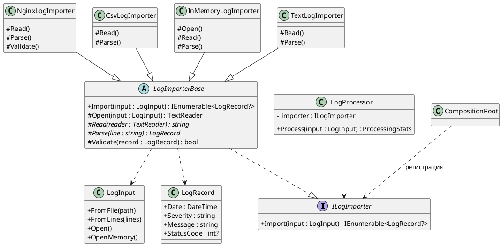
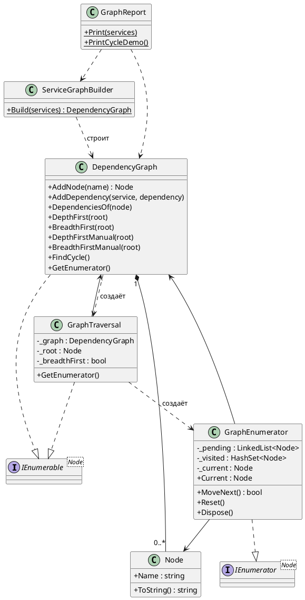
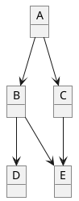
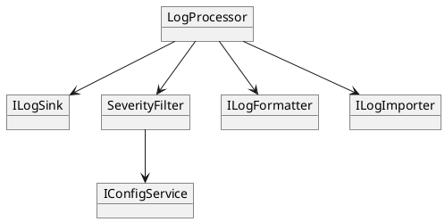

# Лабораторная работа №6 (ЛР 3 практикума). Импорт логов и обход графа

**Студент:** Кириллов Никита, БИСО-02-24

**Вариант:** 12 — логи Nginx (error.log), приёмники SQLite и файл; разбор кода ответа.

**Репозиторий:** https://github.com/securemailcode686-droid/Lecture_Examples

**Pull Request:** https://github.com/securemailcode686-droid/Lecture_Examples/pull/6

## Задача

Расширить LogHub возможностью импорта логов из разных источников с применением Стратегии и Шаблонного метода. Реализовать граф зависимостей сервисов, два способа обхода и обнаружение циклов. Проверить работу ручного итератора и итератора, сгенерированного компилятором.

## Часть A. Импорт логов

| Импортёр | Параметр конфигурации | Назначение |
|---|---|---|
| NginxLogImporter | nginx | Разбор Nginx error.log и HTTP-кодов |
| CsvLogImporter | csv | Разбор CSV с кавычками |
| InMemoryLogImporter | memory | Чтение данных из памяти |
| TextLogImporter | text | Совместимость с предыдущими работами |

LogProcessor получает ILogImporter через конструктор.
CompositionRoot выбирает реализацию через TypeCatalog
на основании параметра importer.

При отсутствии параметра используется TextLogImporter,
что сохраняет поведение предыдущих лабораторных работ.

### Диаграмма классов импортёров



### Шаблонный метод и хук

Невиртуальный метод Import определяет последовательность:

1. Открытие источника.
2. Чтение очередной строки.
3. Разбор записи.
4. Валидация записи.
5. Возврат результата.
6. Освобождение ресурса.

Read и Parse являются абстрактными шагами.
Validate — виртуальный хук, возвращающий true по умолчанию.

NginxLogImporter переопределяет Validate и отклоняет
записи с HTTP-кодами за пределами диапазона 100–599.
Отсутствие кода допускается.

Остальные рабочие импортёры используют реализацию
валидации по умолчанию.

Конструкция using обеспечивает освобождение источника,
в том числе при досрочном завершении перечисления.

### Особенности варианта 12

В LogRecord добавлено необязательное поле StatusCode.

В стандартном Nginx error.log HTTP-код не является
обязательным полем. Импортёр извлекает код из явно
указанных полей сообщения: status, status_code,
upstream status или response code.

Уровни Nginx приводятся к шкале LogHub:

| Nginx | LogHub |
|---|---|
| debug | Debug |
| info, notice | Info |
| warn | Warning |
| error | Error |
| crit, alert, emerg | Critical |

Подготовлен файл LogHub/samples/nginx-error.log
из 60 искусственно сформированных строк.

| Тип записи | Количество |
|---|---:|
| Корректные с HTTP-кодом | 48 |
| Корректные без HTTP-кода | 6 |
| Недопустимый HTTP-код | 3 |
| Некорректные строки | 3 |

### Приёмники

Добавлен SqliteSink на основе Microsoft.Data.Sqlite.
Приёмник создаёт таблицу logs и сохраняет дату,
уровень важности, сообщение, HTTP-код и
отформатированный текст.

SQL-запросы параметризованы.

Существующий DatabaseSink с ConsoleDatabaseStub
сохранён для совместимости с предыдущими работами.

Подготовлены профили:

- LogHub/profiles/nginx-sqlite/loghub.config;
- LogHub/profiles/nginx-file/loghub.config.

Оба профиля проверены запуском одной собранной DLL
без перекомпиляции.

| Приёмник | Записано | Пропущено |
|---|---:|---:|
| SQLite | 54 | 6 |
| Файл | 54 | 6 |

В SQLite сохранено 48 HTTP-кодов и 6 значений NULL.

## Часть B. Итератор и обход графа

DependencyGraph представляет ориентированный граф.
Вершины — сервисы, рёбра — зависимости между ними.

ServiceGraphBuilder строит граф по регистрациям
IServiceCollection и параметрам конструкторов.

### Диаграмма классов графа



### Проверка порядка обхода



DFS: A, B, D, E, C.

BFS: A, B, C, D, E.

DFS использует стек, BFS — очередь.
HashSet предотвращает повторное посещение вершин.

Каждый вызов GetEnumerator у GraphTraversal создаёт
отдельный экземпляр GraphEnumerator. Состояние обхода
не хранится в самой коллекции.

Вложенные foreach проверены автоматическими тестами.

### Граф зависимостей LogHub



Для стандартного профиля получены результаты:

DFS:
LogProcessor -> ILogSink -> SeverityFilter ->
IConfigService -> ILogFormatter -> ILogImporter

BFS:
LogProcessor -> ILogSink -> SeverityFilter ->
ILogFormatter -> ILogImporter -> IConfigService

Ручные реализации возвращают те же последовательности.

### Обнаружение циклов

Метод FindCycle хранит текущий путь, активные
и полностью обработанные вершины.

Повторное посещение активной вершины означает цикл.
Общая зависимость двух сервисов сама по себе
циклом не считается.

На тестовом графе получен результат:

```text
DFS: ServiceA -> ServiceB -> ServiceC
BFS: ServiceA -> ServiceB -> ServiceC
Обнаружен цикл: ServiceA -> ServiceB -> ServiceC -> ServiceA
```

В стандартном графе зависимостей LogHub
циклические зависимости отсутствуют.

## Разбор yield return

Сборка исследована с помощью ILSpy 11.2.0.10050.

В DependencyGraph обнаружены вложенные классы,
созданные компилятором:

- `<BreadthFirst>d__8` — строка 50 IL-вывода;
- `<DepthFirst>d__7` — строка 488 IL-вывода.

Оба класса реализуют `IEnumerable<Node>`,
`IEnumerator<Node>` и IDisposable.

Обнаружены следующие поля:

| Поле | Назначение |
|---|---|
| `<>1__state` | Состояние конечного автомата |
| `<>2__current` | Текущий элемент |
| `<>l__initialThreadId` | Идентификатор начального потока |
| `<visited>5__1` | Множество посещённых узлов |
| `<queue>5__2` | Очередь BFS |
| `<stack>5__2` | Стек DFS |

При yield return компилятор сохраняет текущее
состояние выполнения и возвращаемый элемент.
Следующий вызов MoveNext продолжает выполнение
с соответствующей точки алгоритма.

| Ручной итератор | yield return |
|---|---|
| GraphEnumerator | Сгенерированный вложенный класс |
| MoveNext написан вручную | MoveNext создан компилятором |
| Явное поле _current | Поле `<>2__current` |
| Явное состояние обхода | Конечный автомат |
| Reset реализован | Reset не поддерживается |
| Dispose реализован вручную | Dispose создан компилятором |

Обе реализации ленивые: элементы выдаются
по мере перечисления, а не собираются заранее.

Ручная реализация позволяет явно управлять
состоянием и сбросом итератора. Yield return
сокращает код и позволяет сосредоточиться
на алгоритме обхода.

Независимость перечислений обеспечивается
раздельным состоянием каждого итератора.

## Применённые паттерны

| Паттерн | Где применён | Почему именно он |
|---|---|---|
| Стратегия | ILogImporter в LogProcessor | Формат источника выбирается конфигурацией. Новый импортёр не требует изменения LogProcessor. Наследование самого процессора привело бы к появлению отдельных процессоров для каждого источника. |
| Шаблонный метод | LogImporterBase.Import | Последовательность чтения, разбора и освобождения ресурсов одинакова для импортёров. В наследниках изменяются только отдельные шаги, а общий алгоритм не дублируется. |
| Итератор | GraphTraversal, GraphEnumerator, DepthFirst и BreadthFirst | Состояние обхода вынесено из коллекции. Это позволяет одновременно выполнять несколько обходов и вложенные foreach. |

## Ключевые решения

1. Стратегия и Шаблонный метод используются совместно,
   но решают разные задачи. Стратегия выбирает импортёр
   во время выполнения, а Шаблонный метод фиксирует
   последовательность его внутренних операций.

2. Сохранён TextLogImporter для обратной совместимости.
   Старые профили конфигурации и тестовые сценарии
   продолжают работать без изменения поведения.

3. Некорректные строки возвращаются как null,
   поэтому LogProcessor сохраняет существующую
   статистику пропущенных записей.

4. Для обходов используются независимые итераторы.
   Хранение текущего элемента в самом графе
   нарушило бы работу вложенных foreach.

5. Поиск циклов отделён от обхода. Множество visited
   предотвращает зацикливание, но само по себе
   не позволяет отличить цикл от общей зависимости.

6. SQLite подключён отдельным приёмником через
   существующий каталог реализаций. Заглушка
   предыдущих работ сохранена.

## Тесты

Добавлено 27 автоматических тестов.

| Набор | Количество |
|---|---:|
| LogImporterTests | 12 |
| DependencyGraphTests | 12 |
| ServiceGraphBuilderTests | 3 |
| Всего новых тестов | 27 |

Проверены разбор Nginx и CSV, HTTP-коды,
подмена стратегии, хук валидации, порядок шагов
шаблонного метода и освобождение ресурсов.

Для графа проверены DFS, BFS, вложенные foreach,
циклы, пустой граф, одна вершина, независимость
итераторов, Reset и совпадение двух реализаций.

Итоговый локальный запуск dotnet test:

```text
Всего: 87
Успешно: 86
Сбой: 0
Пропущено: 1
```

Один тест классического синглтона отключён
в предыдущей лабораторной работе намеренно:
он демонстрирует зависимость результата
от порядка выполнения тестов.

Автоматические тесты новой работы не требуют
обращения к диску, сети или внешней базе данных.
Работа SQLite и файлового приёмника дополнительно
проверена отдельными запусками приложения.

## Что не получилось

Стандартный Nginx error.log не гарантирует наличие
HTTP-кода. Поэтому поддерживается извлечение
явно обозначенного кода, а при его отсутствии
сохраняется null.

CSV-импортёр работает с отдельными строками
без заголовка и не поддерживает многострочные поля.

ServiceGraphBuilder рассчитан на используемые
в LogHub регистрации с одной реализацией на тип
сервиса. Фабричные регистрации не поддерживаются.

После добавления SQLite один старый тест каталога
приёмников завершился ошибкой, поскольку ожидал
три реализации вместо четырёх. Ожидаемый перечень
актуализирован, повторное тестирование успешно.

## Источники

- Практикум кафедры КБ-2, раздел 2
  «Паттерны программирования», 2026.
- Учебный репозиторий:
  https://github.com/clgray/Lecture_Examples
- Предыдущие лабораторные работы проекта LogHub.
- Документация C#:
  https://learn.microsoft.com/dotnet/csharp/language-reference/statements/yield
- Microsoft.Data.Sqlite:
  https://learn.microsoft.com/dotnet/standard/data/sqlite/
- ILSpy: https://github.com/icsharpcode/ILSpy
- ChatGPT — помощь в разработке кода, тестов
  и оформлении документации лабораторной работы.
